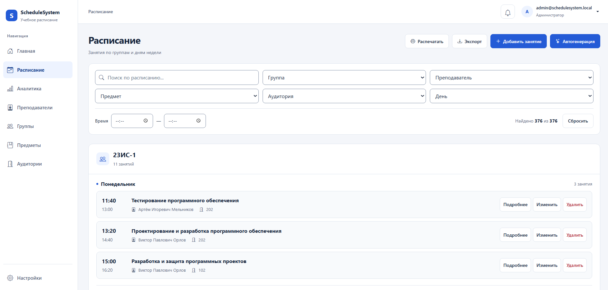
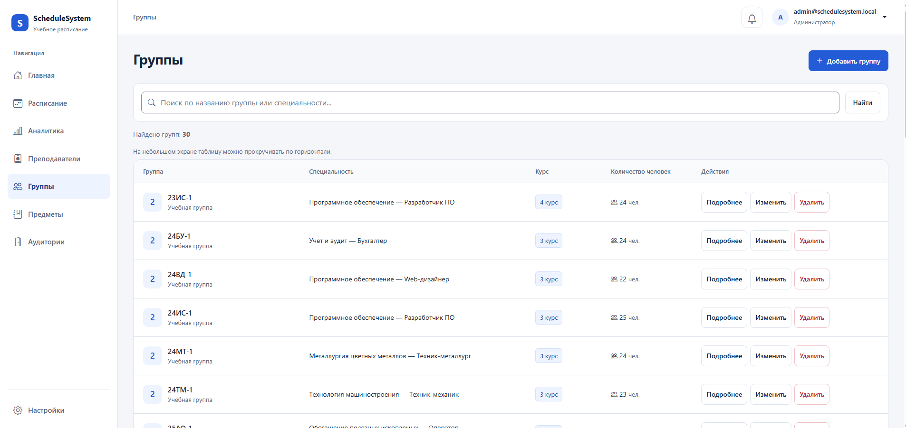
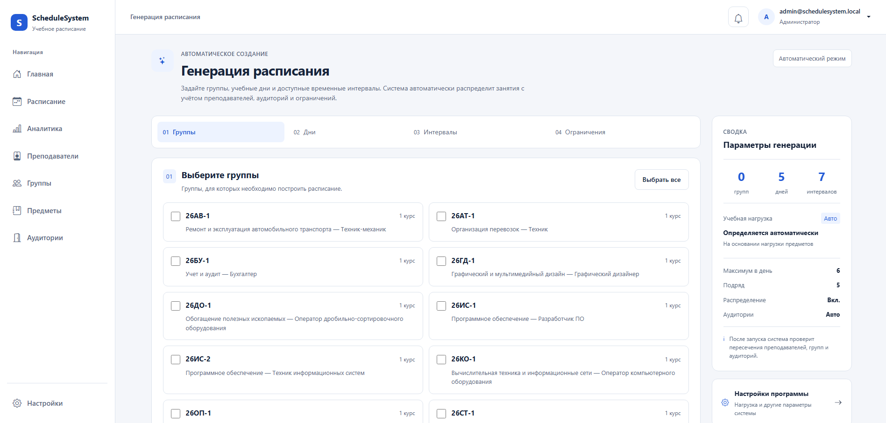
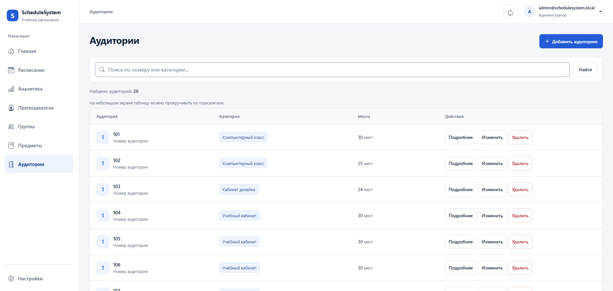

 <div align="center">


<br>


<br><br>


<br><br>

<a href="https://github.com/Artem56x/ScheduleSystem">

</a>
<a href="https://github.com/Artem56x/ScheduleSystem/network/members">

</a>


<br><br>

---

## 📌 About the Project

**ScheduleSystem** is a college timetable management application built with **C#, ASP.NET Core MVC, .NET 8, Entity Framework Core, and PostgreSQL**.

The project helps manage the main entities involved in academic scheduling: student groups, teachers, subjects, classrooms, and lessons.

Beyond basic timetable management, the application includes schedule validation, conflict detection, classroom recommendations, automatic schedule generation, authentication, notifications, audit logs, and data export.

The main objective is to make timetable creation and management more structured while reducing scheduling conflicts and unsuitable classroom assignments.

## 📚 Documentation

Detailed project documentation is available in the `docs/` directory.

| Document | Description |
|---|---|
| [Architecture](docs/Architecture.md) | Application structure and design |
| [Architecture Diagram](docs/ArchitectureDiagram.md) | Visual overview of the application architecture |
| [Database](docs/Database.md) | Database structure and relationships |
| [Database Diagram](docs/DatabaseDiagram.md) | Database relationship diagram |
| [User Guide](docs/UserGuide.md) | Instructions for using the application |
| [Administrator Guide](docs/AdminGuide.md) | Administrative features and workflows |
| [Deployment Guide](docs/Deployment.md) | Configuration and deployment instructions |
| [Technical Documentation](docs/TechnicalDocumentation.md) | Technical details, implementation notes, and validation |

## 🖥️ Application Screenshots

### Schedule Management


### Student Groups


### Automatic Schedule Generation


### Classrooms


## ✨ Features

### 📅 Schedule Management

- Create, edit, and delete schedule entries.
- View the complete timetable.
- Filter schedules by group, teacher, subject, classroom, day, and time.
- View schedules for individual groups and teachers.
- Validate schedule entries before saving.
- Detect conflicting assignments.
- Export schedules into supported formats.

### 🔎 Search and Filtering

Schedule filters help users find specific lessons without browsing the entire timetable.

Available filter dimensions include:

- Student group
- Teacher
- Subject
- Classroom
- Day of the week
- Time

### 🧠 Schedule Validation and Conflict Detection

The application checks scheduling conflicts involving three important resources:

- **Teachers:** prevent overlapping assignments for the same teacher.
- **Student groups:** prevent a group from having overlapping lessons.
- **Classrooms:** prevent a room from being assigned to multiple lessons at the same time.

For example, if one lesson occupies a classroom from 10:00 to 11:30 and another is scheduled from 11:00 to 12:30, their time intervals overlap.

Schedule validation helps identify these conflicts before an invalid timetable is accepted.

### 🏫 Classroom Recommendations

Classroom recommendations consider relevant scheduling requirements, including:

- Classroom capacity and group size.
- Classroom category.
- Subject and classroom requirements.
- Existing classroom assignments.
- Classroom availability.

The purpose is to help select a room that is both suitable for the lesson and available at the required time.

### 🧑‍🏫 Teacher Management

- Create, edit, and delete teacher records.
- View teacher information.
- Associate teachers with multiple subjects.
- View teacher schedules.

Teacher and subject associations use a many-to-many relationship through the `TeacherSubject` entity.

### 👥 Student Group Management

- Manage student groups.
- Store group information, including student count.
- Associate groups with subjects.
- Use group size when selecting suitable classrooms.

### 📚 Subject Management

Subjects are maintained as separate entities and can be associated with teachers, groups, and classroom requirements.

### 🏢 Classroom Management

Classroom records include information such as name, capacity, and category. Classroom categories help determine whether a room is appropriate for a particular lesson.

### 🤖 Automatic Schedule Generation

The application includes an automatic schedule generation module.

The generator works with scheduling constraints and settings such as:

- Teacher and group requirements.
- Subject assignments.
- Classroom capacity and category.
- Existing scheduling conflicts.
- Weekly lesson requirements.
- Maximum lessons per day.
- Teaching days per week.
- Permitted schedule gaps.

#### Default generation settings

| Setting | Default value |
|---|---:|
| Weekly lessons | 3 |
| Maximum lessons per day | 4 |
| Teaching days per week | 5 |
| Maximum gaps per day | 2 |
| Allow gaps | Yes |

These are default generation settings; actual results depend on the available data and constraints.

### 🔔 Notifications

The application includes a notification interface for displaying relevant schedule-related information.

### 📝 Audit Logs

Audit logging records important application events, providing additional visibility into administrative actions and system changes.

### 🔐 Authentication and Authorization

Authentication is implemented using **ASP.NET Core Identity**.

The application supports the `Admin` and `User` roles, with access controlled according to the configured authorization rules.

Administrator credentials should be provided through secure configuration rather than committed to source control.

### 📤 Schedule Export

The application includes export functionality for supported formats:

| Format | Purpose |
|---|---|
| PDF | Printable schedules |
| Excel | Spreadsheet-based schedules |
| CSV | Tabular data export |

Export options depend on the implemented export workflows and available filters.

---

## 🏗️ Architecture

ScheduleSystem follows the **ASP.NET Core MVC** architectural pattern.

```text
                 ┌──────────────────────┐
                 │       Browser        │
                 └──────────┬───────────┘
                            │ HTTP
                            ▼
                 ┌──────────────────────┐
                 │      Controllers     │
                 └──────────┬───────────┘
                            │
               ┌────────────┴────────────┐
               ▼                         ▼
      ┌─────────────────┐      ┌─────────────────┐
      │     Services    │      │      Views      │
      │                 │      │ Razor / HTML    │
      │ Validation      │      └─────────────────┘
      │ Generation      │
      │ Recommendations │
      │ Export          │
      └────────┬────────┘
               │
               ▼
      ┌─────────────────────┐
      │ ApplicationDbContext│
      │ Entity Framework    │
      │ Core                │
      └──────────┬──────────┘
                 │
                 ▼
          ┌──────────────┐
          │  PostgreSQL  │
          └──────────────┘
```

### Main project directories

```text
ScheduleSystem/
├── Controllers/
├── Data/
├── Models/
├── Services/
├── ViewComponents/
├── Views/
├── Migrations/
├── wwwroot/
│   ├── css/
│   └── js/
├── Program.cs
├── appsettings.json
└── ScheduleSystem.csproj
```

### Key services

| Service | Responsibility |
|---|---|
| `ScheduleValidationService` | Schedule validation and conflict checks |
| `ScheduleGeneratorService` | Automatic timetable generation |
| `ClassroomRecommendationService` | Suitable classroom recommendations |
| `ScheduleExportService` | Schedule export functionality |

The application also uses `ApplicationDbContext` for Entity Framework Core database access.

---

## 🛠️ Technology Stack

| Technology | Purpose |
|---|---|
| C# | Main programming language |
| .NET 8 | Application platform |
| ASP.NET Core MVC | Web application framework |
| Entity Framework Core | ORM and database access |
| PostgreSQL | Relational database |
| Npgsql | PostgreSQL provider for .NET |
| ASP.NET Core Identity | Authentication and authorization |
| Razor | Server-rendered views |
| HTML5 | Page structure |
| CSS3 | Styling and responsive layout |
| JavaScript | Client-side interactions |
| Git and GitHub | Version control and collaboration |

---

## 🎨 UI and Responsive Design

The application uses a light interface with blue accents, consistent forms and buttons, responsive navigation, and shared visual components.

The interface includes schedule management, CRUD pages, account screens, notifications, audit logs, analytics, export workflows, and generator-related screens.

Existing CSS files include:

- `wwwroot/css/site.css` — shared styles, typography, forms, tables, and interface states.
- `wwwroot/css/liquid-glass.css` — shared layout and navigation styling. The filename is retained for compatibility.

The interface work also addresses keyboard navigation, dialog focus handling, validation feedback, and responsive layouts.

Some accessibility and browser-specific behaviors still require manual acceptance testing. Refer to the technical documentation for the recorded validation results and limitations.

---

## 🗄️ Database

ScheduleSystem uses **PostgreSQL** and **Entity Framework Core**.

The configured database name is:

```text
schedulesystem
```

### Main domain entities

- `ApplicationUser`
- `Teacher`
- `TeacherSubject`
- `Subject`
- `Group`
- `GroupSubject`
- `Classroom`
- `ClassroomCategory`
- `Schedule`
- `Notification`
- `AuditLog`

The database also contains entities used by schedule generation and subject/classroom requirements.

Entity Framework Core migrations are included in the repository.

---

## ⚙️ Installation

### Prerequisites

Install the following tools before running the application:

- [.NET 8 SDK](https://dotnet.microsoft.com/en-us/download/dotnet/8.0)
- [PostgreSQL](https://www.postgresql.org/download/)
- [Git](https://git-scm.com/downloads)
- Entity Framework Core CLI tools

Check the installed .NET SDK:

```powershell
dotnet --version
```

### 1. Clone the repository

```powershell
git clone https://github.com/Artem56x/ScheduleSystem.git
cd ScheduleSystem
```

### 2. Configure PostgreSQL

Create a PostgreSQL database named:

```text
schedulesystem
```

Configure the connection string using the application's expected configuration key, `DefaultConnection`.

For local development, use User Secrets or an environment-specific configuration file that is excluded from version control. Do not commit database passwords or other secrets.

### 3. Restore dependencies

```powershell
dotnet restore
```

### 4. Configure the database schema

If the EF Core CLI is not installed, install it:

```powershell
dotnet tool install --global dotnet-ef
```

If it is already installed, update it as appropriate for your .NET environment.

Apply the migrations:

```powershell
dotnet ef database update
```

### 5. Configure the administrator password

If the application is configured to read the administrator password from `Admin:Password`, PowerShell can provide it as an environment variable:

```powershell
$env:Admin__Password = "YOUR_ADMIN_PASSWORD"
```

Use a strong local password. Do not replace the placeholder with a real password in the README or commit credentials to Git.

### 6. Build the application

```powershell
dotnet build
```

### 7. Run the application

```powershell
dotnet run
```

Open the local URL printed in the terminal.

> **Note:** These are the standard project setup steps. Actual startup requirements depend on the repository's current configuration, database connection, and administrator seeding settings.

---

## 🧰 Common Entity Framework Core Commands

Create a migration after changing the data model:

```powershell
dotnet ef migrations add MigrationName
```

Apply migrations to the configured database:

```powershell
dotnet ef database update
```

Check for pending model changes:

```powershell
dotnet ef migrations has-pending-model-changes
```

Run these commands from the project directory with the appropriate database configuration.

---

## 🔒 Security Considerations

The application uses ASP.NET Core Identity and role-based authorization.

Important security practices include:

- Keep passwords and connection secrets out of source control.
- Use environment-specific configuration for local and production environments.
- Verify authorization on protected controller actions.
- Validate user input on the server.
- Configure HTTPS and secure cookies for production.
- Restrict production database access.
- Use appropriate logging and secret-management practices.

A successful local build does not by itself establish that the application is ready for production deployment.

---

## 📊 Project Status

**Core workflows are implemented.** This status does not imply production readiness or completion of every manual acceptance check.

At the documented UI refresh checkpoint on **October 9, 2026**:

- The .NET 8 restore and build completed successfully with no warnings or errors.
- Testing against an isolated PostgreSQL database recorded 108 HTTP requests matching the baseline across covered workflows.
- Checks covered rendered screens, form contracts, JavaScript syntax, and responsive layouts.
- Native browser print pagination, actual 200% browser zoom, and real on-screen keyboard behavior still required manual acceptance.
- Known access-denied routing and home notification-scope issues were recorded in the technical documentation.

### Implemented functionality

- [x] ASP.NET Core MVC application
- [x] PostgreSQL and Entity Framework Core
- [x] Authentication and role-based authorization
- [x] Teacher management
- [x] Subject management
- [x] Student group management
- [x] Classroom management and categories
- [x] Group-subject and teacher-subject relationships
- [x] Schedule management and filtering
- [x] Schedule validation and conflict detection
- [x] Automatic schedule generation
- [x] Classroom recommendations
- [x] Notifications and audit logs
- [x] Schedule export functionality
- [x] User profile and settings
- [x] Responsive interface improvements
- [x] Entity Framework Core migrations

### Possible future improvements

- Further timetable optimization.
- More detailed analytics and reporting.
- Calendar integrations.
- Email notifications.
- A dedicated mobile application.
- A REST API, if needed.
- Containerized deployment with Docker.
- Cloud deployment and monitoring.

---

## 👨‍💻 My Contribution

I developed and improved ScheduleSystem as part of my software development practice.

My work included contributing to application functionality, database-backed MVC workflows, scheduling logic, and user interface improvements.

Areas of work included:

- Developing and improving ASP.NET Core MVC modules.
- Working with PostgreSQL and Entity Framework Core.
- Implementing schedule-related business logic and validation.
- Working on automatic schedule generation and classroom recommendations.
- Improving authentication-related and user-facing workflows.
- Refining interface consistency, responsiveness, and usability.
- Testing application workflows and documenting technical limitations.

**Technologies used:** C#, .NET 8, ASP.NET Core MVC, Entity Framework Core, PostgreSQL, Git, and GitHub.

_Keep this section aligned with the features you personally implemented or improved._

---

## 🎓 Project Information

| Property | Value |
|---|---|
| Project | ScheduleSystem |
| Platform | Web application |
| Language | C# |
| Framework | ASP.NET Core MVC |
| Runtime | .NET 8 |
| Database | PostgreSQL |
| ORM | Entity Framework Core |
| Architecture | MVC |
| Context | College software development practice |

---

## 👨‍💻 Author

**Artem Dudnik**

Software Development Student · Kazakhstan

[](https://github.com/Artem56x)

[View ScheduleSystem on GitHub](https://github.com/Artem56x/ScheduleSystem)

---

<div align="center">

**Built with C# and ASP.NET Core**


</div>
