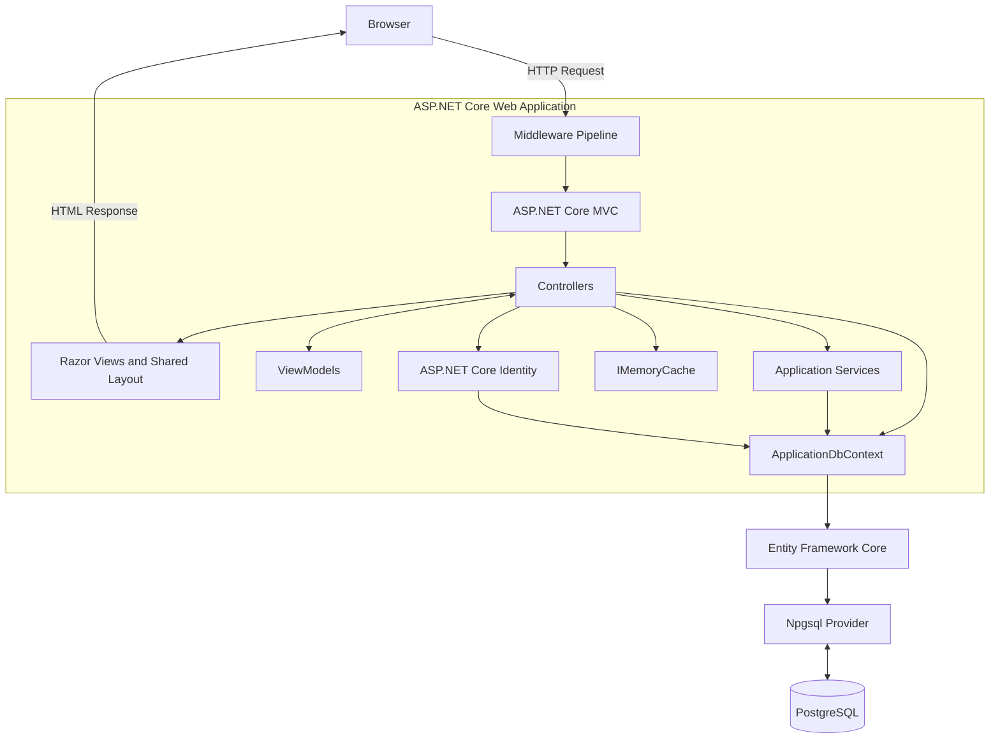
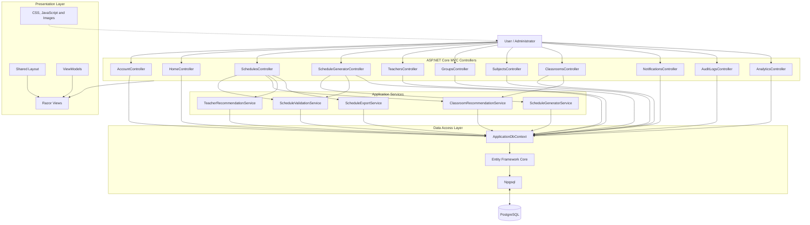
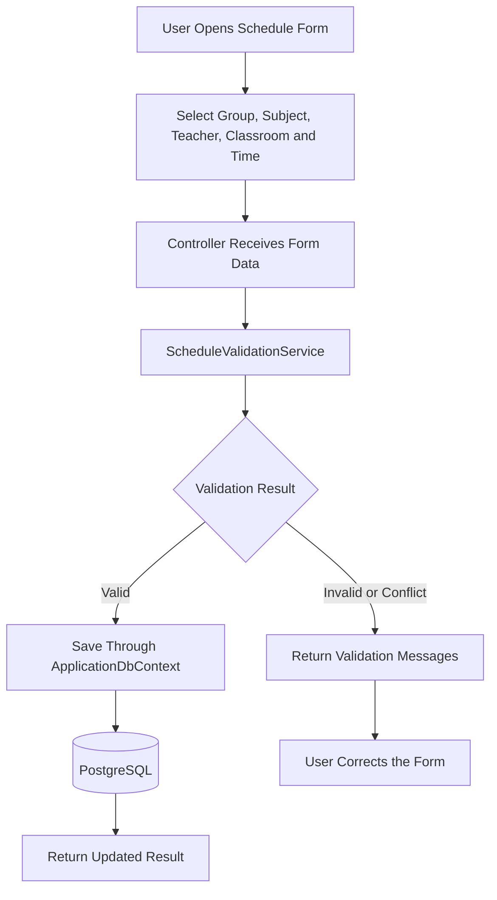
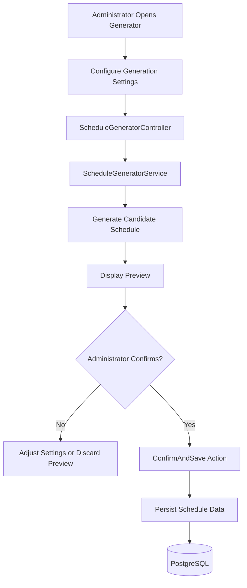
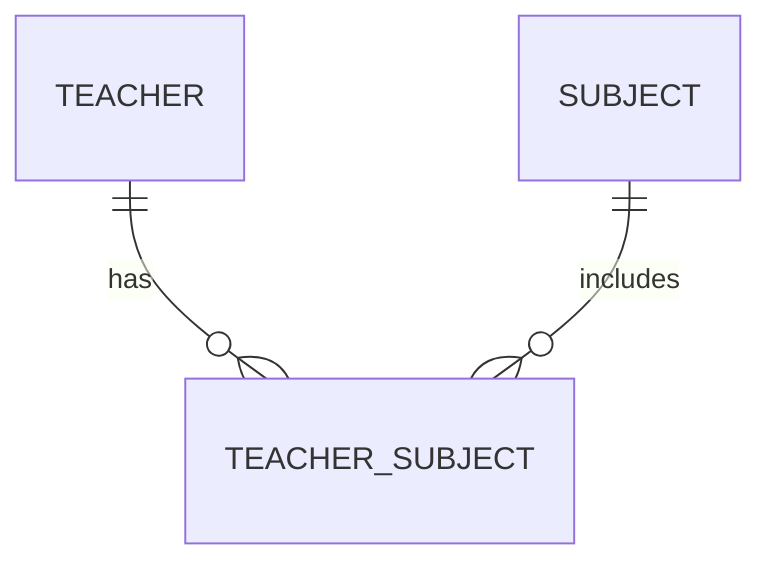
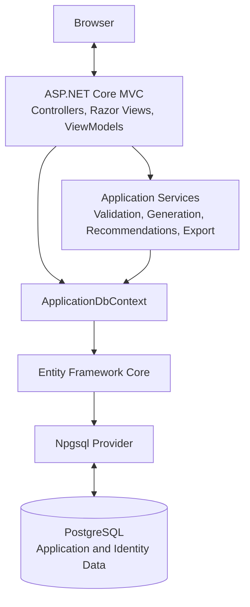

# Architecture Diagram

## Overview

ScheduleSystem is an ASP.NET Core MVC web application built on .NET 8. It uses Razor Views for the user interface, Entity Framework Core for data access, Npgsql as the PostgreSQL provider, and ASP.NET Core Identity for authentication and role-based authorization.

The project uses application services for selected business operations. Some controllers also access `ApplicationDbContext` directly, so the architecture is service-oriented but not a strict layered architecture in which every database operation passes through a service.

## High-Level Architecture



The diagram represents the main logical components. Not every request passes through every layer. Static files in `wwwroot` may be served directly by the static-file middleware without reaching a controller.

## Full Component Diagram



The diagram shows the main application areas and their relationships. Exact routes and available actions are defined by the corresponding controllers.

## Layer Responsibilities

### 1. Presentation Layer

The presentation layer displays information and provides interaction for users.

Its main components include:

- Razor Views;
- Shared Layout;
- ViewModels;
- CSS stylesheets;
- JavaScript files;
- static images and other resources.

The presentation layer does not connect directly to the PostgreSQL database. Data is supplied by controllers and application logic.

### 2. Controllers

Controllers process HTTP requests, coordinate operations, and return views or other responses.

| Controller | Responsibility |
|---|---|
| `HomeController` | Main page and dashboard |
| `SchedulesController` | Schedule management, filtering, validation and export actions |
| `ScheduleGeneratorController` | Automatic schedule generation |
| `TeachersController` | Teacher management |
| `GroupsController` | Group management |
| `SubjectsController` | Subject management |
| `ClassroomsController` | Classroom management |
| `NotificationsController` | Notification operations |
| `AuditLogsController` | Audit-log viewing |
| `AnalyticsController` | Statistics and analytics |
| `AccountController` | Account and authentication-related operations |

Controllers coordinate application operations. Reusable business logic is placed in services where appropriate, although some controllers access `ApplicationDbContext` directly.

## 3. Application Services

Application services implement reusable operations related to schedule management, validation, recommendations, generation, and exporting.

### ScheduleValidationService

`ScheduleValidationService` checks schedule entries and relevant constraints.

The validation process may include:

- teacher scheduling conflicts;
- group scheduling conflicts;
- classroom scheduling conflicts;
- valid days and time intervals;
- valid references to related entities;
- group-course and subject-course compatibility;
- teacher-subject assignments;
- classroom capacity;
- classroom category requirements.

Depending on the validation rule, a problem may produce an error or a warning that requires confirmation.

### ScheduleGeneratorService

`ScheduleGeneratorService` generates a candidate timetable using configured parameters and constraints.

The generator considers:

- groups;
- subjects;
- teachers;
- teacher-subject assignments;
- classrooms;
- classroom categories;
- classroom capacity;
- weekly lesson requirements;
- daily lesson limits;
- teaching days;
- available time slots;
- lesson distribution and gaps.

Simplified workflow:

```text
Generation Settings
        |
        v
Groups and Subjects
        |
        v
Teacher-Subject Assignments
        |
        v
Available Teachers and Classrooms
        |
        v
Constraint Processing
        |
        v
Candidate Schedule
        |
        v
Preview and Confirmation
```

The generator uses constraint processing and bounded search. A complete valid schedule cannot be guaranteed for every combination of input data and restrictions.

### ClassroomRecommendationService

`ClassroomRecommendationService` helps identify suitable classrooms for a group and subject.

The recommendation process considers relevant requirements such as:

```text
Subject Requirements
        |
        v
Classroom Category
        |
        v
Classroom Capacity
        |
        v
Availability and Conflicts
        |
        v
Suitable Classrooms
```

A suitable classroom must meet the relevant category and capacity requirements and satisfy applicable scheduling constraints.

### TeacherRecommendationService

`TeacherRecommendationService` supports teacher recommendations for schedule-related operations.

Recommendations use relevant teacher, subject, and scheduling information to help identify appropriate teachers. Actual eligibility and availability are determined by the implemented application rules.

### ScheduleExportService

`ScheduleExportService` provides schedule export functionality.

The project uses:

- **Excel** — workbook processing through ClosedXML;
- **PDF** — document generation through QuestPDF.

Simplified workflow:

```text
Schedule Data
      |
      v
ScheduleExportService
      |
      +----> Excel
      |
      +----> PDF
```

CSV support should only be documented if a corresponding implementation is added or verified in the source code.

## 4. Data Access Layer

The primary data access component is `ApplicationDbContext`.

It inherits from `IdentityDbContext<ApplicationUser>`, integrating the application's domain entities with ASP.NET Core Identity.

The context contains entity sets for the main application data:

```text
ApplicationDbContext
        |
        +---- Teachers
        +---- TeacherSubjects
        +---- Groups
        +---- GroupSubjects
        +---- Subjects
        +---- Classrooms
        +---- ClassroomCategories
        +---- SubjectClassroomCategories
        +---- Schedules
        +---- ScheduleTimeSlots
        +---- ScheduleGenerationSettings
        +---- Notifications
        +---- AuditLogs
        +---- Identity Entities
```

Entity Framework Core provides object-relational mapping and translates queries into database operations. Npgsql connects Entity Framework Core to PostgreSQL.

## 5. Database Layer

The application uses PostgreSQL as its relational database management system.

```text
ApplicationDbContext
        |
        v
Entity Framework Core
        |
        v
Npgsql Provider
        |
        v
PostgreSQL
```

The database stores both application data and ASP.NET Core Identity data. Relationships, keys, and delete behaviors are configured through the Entity Framework Core model.

## Request Lifecycle

A typical dynamic request follows this sequence:

```text
Browser
   |
   | HTTP / HTTPS Request
   v
ASP.NET Core Middleware
   |
   v
MVC Routing
   |
   v
Controller Action
   |
   +----> Application Service (when needed)
   |
   +----> ApplicationDbContext (where used)
                 |
                 v
          Entity Framework Core
                 |
                 v
               Npgsql
                 |
                 v
             PostgreSQL
                 |
                 | Query Results / Saved Changes
                 v
          ApplicationDbContext
                 |
                 v
          Service / Controller
                 |
                 v
          Razor View or Response
                 |
                 v
              Browser
```

Not every request requires a database query or application service. Static-file requests may be handled by middleware before MVC routing.

## Schedule Creation Flow

Manual schedule creation involves entering the lesson details and validating them before saving.



The validation step helps prevent conflicting schedule entries. The exact fields and confirmation behavior depend on the relevant controller action and view.

## Automatic Schedule Generation Flow

Automatic generation follows a preview-and-confirm workflow.



The generated preview is temporarily stored in memory cache with a limited lifetime. The administrator confirms the result before it is saved.

The controller's form defaults may differ from the defaults declared by the generation request model. These defaults should be considered separately when documenting or modifying the generator.

## Authentication and Authorization

ASP.NET Core Identity manages user authentication and supports role-based authorization.

The application uses:

- `ApplicationUser` for user accounts;
- `Admin` and `User` roles;
- password validation rules configured in `Program.cs`;
- lockout settings for repeated failed login attempts;
- cookie paths for login and access-denied pages.

`ScheduleGeneratorController` is restricted to administrators using the `[Authorize(Roles = "Admin")]` attribute.

Simplified authentication flow:

```text
User
  |
  v
Login Form
  |
  v
ASP.NET Core Identity
  |
  +---- Authentication
  +---- Password Validation
  +---- Role-Based Authorization
  |
  v
Authorized Controller
  |
  v
Application Response
```

Authentication identifies the user. Authorization determines whether the user has permission to access a protected endpoint.

## Teacher-Subject Relationship

Teachers and subjects have a many-to-many relationship through the explicit `TeacherSubject` entity.



The join entity uses a composite key consisting of `TeacherId` and `SubjectId`.

This relationship allows:

- one teacher to teach multiple subjects;
- one subject to be assigned to multiple teachers;
- validation to check actual teacher-subject assignments;
- the generator to select teachers based on subject assignments.

## Dependency Injection

The application uses ASP.NET Core dependency injection to register the database context and application services.

Controllers receive their dependencies through constructors.

```text
Controller
    |
    +---- Application Service (where needed)
    |
    +---- ApplicationDbContext (where needed)
    |
    +---- Framework Service
```

Dependency injection keeps dependencies explicit and makes it easier to maintain and test individual components.

The service layer is not absolute: some controllers work with `ApplicationDbContext` directly.

## Configuration

Application configuration is kept separate from application logic.

Important settings include:

- PostgreSQL connection string;
- ASP.NET Core environment;
- Identity options;
- administrator seed password.

The database connection is configured through `DefaultConnection`.

The administrator seed password is read from `Admin:Password` and can be supplied using the environment variable:

```text
Admin__Password
```

Sensitive credentials should be provided through environment variables, user secrets, or another secure configuration provider. Real passwords should not be committed to source control.

## Security Architecture

Security is implemented through several mechanisms:

```text
HTTPS and Middleware
        |
        v
Authentication
        |
        v
Authorization
        |
        v
Role Checks
        |
        v
Request and Business Validation
        |
        v
Entity Framework Core
        |
        v
Database Constraints
```

Important security measures include HTTPS redirection, production HSTS configuration, Identity authentication, role-based authorization, server-side validation, and database relationship constraints.

The presence of an audit-log entity does not by itself mean that every application action is logged. Audit coverage depends on the code that records audit entries.

## Project Structure

The following is a representative overview of the repository structure:

```text
ScheduleSystem/
|
+---- Controllers/
|
+---- Data/
|
+---- Migrations/
|
+---- Models/
|     |
|     +---- Generator/
|
+---- Services/
|
+---- ViewComponents/
|
+---- ViewModels/
|
+---- Views/
|
+---- wwwroot/
|     |
|     +---- css/
|     +---- js/
|     +---- images/
|
+---- docs/
|
+---- Program.cs
+---- appsettings.json
+---- ScheduleSystem.csproj
```

This structure is representative rather than an exhaustive listing of every file.

## Architecture Principles

### Separation of Responsibilities

Each component has a defined purpose:

```text
Controller
    |
    v
Request Coordination

Service
    |
    v
Reusable Business Logic

ApplicationDbContext
    |
    v
Data Access

PostgreSQL
    |
    v
Persistent Storage
```

### Reusable Business Logic

Validation, generation, classroom recommendations, teacher recommendations, and export operations are implemented as separate services.

### Database Abstraction

Entity Framework Core provides an abstraction over database access, while Npgsql supplies the PostgreSQL-specific provider.

### Maintainability

The separation of components makes it easier to update schedule generation, validation, or data access without rewriting unrelated parts of the application.

### Extensibility

The architecture can be extended with additional services, reports, analytics, and integration features. As the application grows, more data access and business logic could be moved out of controllers into dedicated services.

## Architecture Summary



ScheduleSystem combines ASP.NET Core MVC request handling, Razor-based rendering, reusable application services, Entity Framework Core data access, PostgreSQL persistence, and ASP.NET Core Identity.

This architecture provides a foundation for maintainability and future improvements while reflecting the current combination of service-based logic and direct controller access to the database context.
