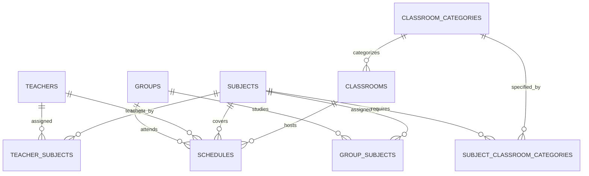
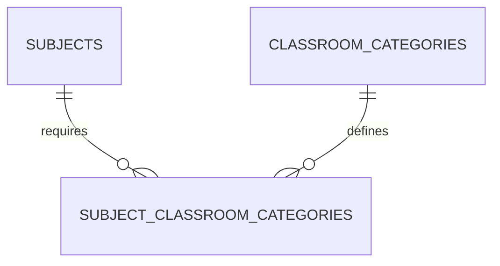

# ScheduleSystem — Database Documentation

## 1. Overview

ScheduleSystem uses PostgreSQL as its relational database management system and Entity Framework Core as its Object-Relational Mapping (ORM) framework.

The project follows the Code First approach, where the database schema is managed through C# entity models, Entity Framework Core configuration, and migrations.

```text
C# Entity Models
       |
       v
Entity Framework Core
       |
       v
EF Core Migrations
       |
       v
PostgreSQL Database
```

The database stores educational data, timetable entries, generation settings, application users, notifications, and audit records.

## 2. Database Configuration

The application uses PostgreSQL and connects through the Npgsql Entity Framework Core provider.

The connection string is configured using the `DefaultConnection` setting.

The database name used by the project is:

```text
schedulesystem
```

Connection credentials should be supplied through secure configuration and should not be committed to source control.

## 3. Main Entities

The application's main entity sets include:

- `Teachers`
- `TeacherSubjects`
- `Groups`
- `GroupSubjects`
- `Subjects`
- `Classrooms`
- `ClassroomCategories`
- `SubjectClassroomCategories`
- `Schedules`
- `ScheduleTimeSlots`
- `ScheduleGenerationSettings`
- `Notifications`
- `AuditLogs`

ASP.NET Core Identity adds its own entities for user accounts, roles, claims, logins, tokens, and related relationships.

The exact physical database schema is determined by the entity models, Fluent API configuration, and applied migrations.

## 4. Entity Relationship Overview

The main domain relationships can be represented conceptually as follows:



This diagram illustrates the main conceptual relationships. The exact foreign-key names, optional relationships, and cardinalities should be checked against the current model configuration and migrations.

## 5. Teachers

The `Teachers` entity stores information about teachers.

Teachers can be associated with multiple subjects through the `TeacherSubjects` join entity.

These assignments are used by schedule validation and automatic generation to identify appropriate teachers for lessons.

## 6. Subjects

The `Subjects` entity represents academic subjects.

Subject information is used when assigning lessons to groups, selecting teachers, validating schedules, and determining classroom requirements.

Subject-to-group assignments are represented by `GroupSubjects`, while teacher assignments are represented by `TeacherSubjects`.

Classroom category requirements are represented through `SubjectClassroomCategories`.

## 7. TeacherSubjects

`TeacherSubjects` represents the many-to-many relationship between teachers and subjects.

The relationship uses the following key fields:

```text
TeacherId
SubjectId
```

The entity is configured with a composite primary key:

```text
(TeacherId, SubjectId)
```

Conceptual relationship:

```text
Teachers
    |
    | 1:N
    v
TeacherSubjects
    ^
    | N:1
    |
Subjects
```

This design supports:

- one teacher teaching multiple subjects;
- one subject being taught by multiple teachers;
- validation of teacher-subject assignments;
- selection of eligible teachers during schedule generation.

The composite key prevents duplicate pairs of teacher and subject identifiers.

## 8. Groups

The `Groups` entity stores information about student groups.

Relevant information includes the group name, course, and student count, according to the properties defined by the model.

The student count is important for classroom selection.

For example, if a group has 24 students, a classroom must have sufficient capacity to accommodate the group.

## 9. GroupSubjects

`GroupSubjects` represents the relationship between student groups and subjects.

This relationship provides the application with information about which subjects are assigned to particular groups.

The assignments can support timetable generation and validation by identifying the subjects that a group is expected to study.

The exact attributes and constraints of this entity are defined by the current model.

## 10. Classrooms

The `Classrooms` entity stores information about available classrooms.

Classroom data is used during manual scheduling, automatic generation, and classroom recommendations.

Relevant properties include classroom identification, capacity, and category relationships as defined by the model.

The application can compare group size with classroom capacity when evaluating suitable rooms.

## 11. ClassroomCategories

`ClassroomCategories` defines categories used to classify classrooms.

Examples may include:

- standard classroom;
- computer classroom;
- specialized classroom.

The actual categories depend on the application's configured data.

Using categories allows the application to represent classroom requirements more flexibly than a single Boolean property.

## 12. SubjectClassroomCategories

`SubjectClassroomCategories` connects subjects with classroom categories.

This relationship allows a subject to specify the types of classrooms that may be appropriate for its lessons.

The entity uses a composite key consisting of:

```text
SubjectId
ClassroomCategoryId
```

The relationship is configured in `ApplicationDbContext`.

Conceptual relationship:



The relationship supports classroom recommendations and schedule validation.

## 13. Schedules

The `Schedules` entity stores timetable entries.

A schedule entry connects relevant educational entities and scheduling information, such as:

- group;
- teacher;
- subject;
- classroom;
- day and time information.

The precise properties and relationships are defined by the schedule model and EF Core configuration.

Schedule data is used by:

- timetable views and filters;
- schedule validation;
- automatic generation;
- teacher recommendations;
- classroom recommendations;
- export functionality;
- related application operations.

## 14. ScheduleTimeSlots

`ScheduleTimeSlots` stores reusable lesson time-slot information.

Time slots allow the application to work with standardized lesson periods.

Example periods might be:

```text
08:30–09:30
09:40–10:40
10:50–11:50
```

These times are illustrative; actual values depend on the application's configured schedule.

The generator can use available time slots when constructing a candidate timetable.

## 15. ScheduleGenerationSettings

`ScheduleGenerationSettings` stores configuration associated with automatic schedule generation.

Relevant scheduling parameters include lesson requirements, teaching days, daily limits, and gap-related constraints, depending on the model properties.

The generator also has request-level settings and controller form defaults. These are not necessarily identical to the values stored in the database.

Therefore, database defaults, model defaults, and user-interface defaults should be documented separately rather than treated as one universal set of defaults.

## 16. Notifications

The `Notifications` entity stores notification records for the application.

Notifications can be used to display relevant information to users.

The exact notification fields, including recipient, message, creation time, and read state, are defined by the current model.

The existence of a notification table does not imply that the application uses a real-time messaging broker or push-notification infrastructure.

## 17. AuditLogs

The `AuditLogs` entity stores audit-related records.

Audit data can support administrative review, troubleshooting, and accountability.

The precise fields are defined by the current audit-log model.

The presence of the entity alone does not guarantee that every application action is recorded; audit coverage depends on the code that creates audit entries.

## 18. ASP.NET Core Identity

ScheduleSystem integrates ASP.NET Core Identity with its application database context.

Identity manages account and authentication-related data, including entities for:

- users;
- roles;
- user-role relationships;
- claims;
- external or application logins;
- authentication tokens.

The application uses the `ApplicationUser` type and configures the roles `Admin` and `User`.

Identity entities and application entities share the `ApplicationDbContext` and use the configured PostgreSQL database.

## 19. ApplicationDbContext

The application's database context is named:

```csharp
ApplicationDbContext
```

It inherits from:

```csharp
IdentityDbContext<ApplicationUser>
```

This enables the context to manage application entities and ASP.NET Core Identity data.

The context defines entity sets for teachers, groups, subjects, classrooms, schedules, generation settings, notifications, audit logs, and the related join entities.

The model also configures relationships, composite keys, and delete behaviors using Entity Framework Core.

## 20. Primary Keys

Primary keys uniquely identify database records.

The exact key type depends on the entity definition. Entities commonly use individual identifiers, while certain join entities use composite keys.

For example, `TeacherSubjects` uses:

```text
TeacherId + SubjectId
```

The `SubjectClassroomCategories` relationship also uses a composite key:

```text
SubjectId + ClassroomCategoryId
```

These composite keys represent the identity of each relationship rather than a separate relationship identifier.

## 21. Foreign Keys and Relationships

Foreign keys maintain relationships between related entities.

Examples include:

```text
TeacherSubjects.TeacherId
        |
        v
Teachers
```

```text
TeacherSubjects.SubjectId
        |
        v
Subjects
```

```text
SubjectClassroomCategories.SubjectId
        |
        v
Subjects
```

```text
SubjectClassroomCategories.ClassroomCategoryId
        |
        v
ClassroomCategories
```

Schedule records also reference the entities needed to represent timetable entries.

The exact foreign-key property names and delete behaviors should be verified in `ApplicationDbContext` and the migration files.

## 22. Referential Integrity

Referential integrity helps keep related data consistent.

Entity Framework Core relationship configuration and PostgreSQL constraints enforce the relationships defined by the model.

Delete behaviors are configured for individual relationships. As a result, deletion may be restricted, cascaded, or handled according to the specific configuration.

Developers should review the configured delete behavior before removing records that may be referenced by schedules or other entities.

## 23. Schedule Validation and Database Data

The database stores the information required by the schedule validation logic.

Depending on the validation rule, the application may use:

- teacher assignments;
- group and subject relationships;
- classroom capacity;
- classroom category requirements;
- schedule day and time;
- existing timetable entries;
- related entity identifiers.

The validation service evaluates scheduling constraints using this data before the application accepts or saves a schedule entry.

Application-level validation and database constraints serve different purposes: validation checks business rules, while database constraints protect the integrity of persisted relationships.

## 24. Entity Framework Core Migrations

Migrations manage database schema changes over the project's development lifecycle.

A migration records a set of schema operations based on changes to the entity model and configuration.

The repository contains migration files for application schema changes. The exact changes represented by each migration should be reviewed in the migration source files.

Migrations help keep development and deployment database schemas consistent.

## 25. Applying Existing Migrations

To apply the existing migrations to the configured database, run the following command from the project directory:

```powershell
dotnet ef database update
```

Before running the command, verify that:

- the PostgreSQL server is running;
- the connection string is configured correctly;
- the target database is available;
- the environment provides the necessary credentials.

This command changes the database schema and should be used carefully when working with production data.

## 26. Creating a Migration

When an intentional change is made to the data model, a new migration can be created with:

```powershell
dotnet ef migrations add MigrationName
```

Replace `MigrationName` with a meaningful name describing the change.

For example:

```powershell
dotnet ef migrations add AddNewScheduleProperty
```

Review the generated migration before applying it. A migration should represent an intentional model change, not an unexplained difference.

## 27. Checking for Pending Model Changes

To check whether the current EF Core model differs from the latest migration snapshot, run:

```powershell
dotnet ef migrations has-pending-model-changes
```

Run this command from the project directory in an environment where the EF Core tools and project dependencies are available.

Unexpected pending changes should be reviewed before release or deployment.

## 28. Database Backup and Recovery

Backups help protect data against accidental deletion, migration problems, and infrastructure failures.

Before significant schema changes or deployments, create a PostgreSQL backup using an appropriate backup procedure.

Backups are particularly important before:

- applying structural migrations to a production database;
- deleting large amounts of data;
- upgrading a production deployment;
- changing database configuration.

A backup strategy should also include periodic testing of the restoration process.

## 29. Data Integrity Recommendations

To maintain reliable database data:

1. Keep group names and subject records consistent.
2. Maintain accurate student counts.
3. Keep classroom capacities and categories up to date.
4. Maintain correct teacher-subject assignments.
5. Verify group-subject assignments.
6. Avoid unnecessary manual changes to production tables.
7. Use migrations for schema changes.
8. Back up important databases before major operations.
9. Review relationship delete behaviors before removing records.

## 30. Database Security

The database contains application data and user-related information.

Recommended security practices include:

- using strong database credentials;
- limiting network access to PostgreSQL;
- avoiding committed passwords and connection secrets;
- using secure configuration providers;
- limiting database permissions according to operational needs;
- creating regular backups;
- separating development and production credentials.

The administrator seed password should also be supplied through secure configuration rather than stored as a real password in source code.

## 31. Database Architecture Summary

The main data architecture can be summarized as follows:

```text
                    PostgreSQL
                         |
                         v
                ApplicationDbContext
                         |
             +-----------+-----------+
             |                       |
             v                       v
     Application Entities      Identity Entities
             |                       |
       +-----+------+           +----+----+
       |     |      |           |         |
    Teachers Groups Subjects   Users     Roles
       |     |      |
       |     |      +---- TeacherSubjects
       |     |
       |     +----------- GroupSubjects
       |
       +------------------ Schedules
                              |
                 +------------+------------+
                 |                         |
                 v                         v
             Classrooms              Time Slots
                 |
                 v
        ClassroomCategories
```

This diagram is a conceptual overview, not a complete physical ER diagram of every table and foreign key.

## 32. Data Flow

A typical scheduling operation follows this path:

```text
User Input
    |
    v
MVC Controller
    |
    v
Validation / Application Logic
    |
    v
ApplicationDbContext
    |
    v
Entity Framework Core
    |
    v
Npgsql Provider
    |
    v
PostgreSQL
```

When data is retrieved, the result travels back through the data access and application layers. A controller can then prepare a ViewModel and return a Razor View to the browser.

Not all controller actions use the same sequence: some access the database context directly, while others use application services.

## 33. Database and Business Logic

PostgreSQL provides persistent storage and enforces configured relational constraints.

Business operations such as timetable validation, generation, recommendations, and exporting are implemented in the application layer.

Important services include:

- `ScheduleValidationService`;
- `ScheduleGeneratorService`;
- `ClassroomRecommendationService`;
- `TeacherRecommendationService`;
- `ScheduleExportService`.

This separation keeps complex scheduling algorithms out of the database schema while allowing the application to use stored data to evaluate scheduling rules.

## 34. Database and Export

Schedule information stored in PostgreSQL can be retrieved by the application and converted into export documents.

The general process is:

```text
PostgreSQL
    |
    v
Entity Framework Core
    |
    v
ApplicationDbContext / Application Logic
    |
    v
ScheduleExportService
    |
    +----> Excel
    |
    +----> PDF
```

The database remains the persistent source of schedule data. Export formats depend on the functionality implemented by the export service and its calling controller.

## 35. Database Verification

Before releasing a new version, build the application:

```powershell
dotnet build
```

Then check the EF Core model for pending changes:

```powershell
dotnet ef migrations has-pending-model-changes
```

If the database schema must be updated, apply the reviewed migrations:

```powershell
dotnet ef database update
```

A successful build does not by itself prove that the application can connect to PostgreSQL. Database connectivity and migration execution should be tested separately in the target environment.

## 36. Current Database Design

The current design focuses on:

- relational storage using PostgreSQL;
- Entity Framework Core data access;
- migration-based schema management;
- explicit foreign-key relationships;
- many-to-many teacher-subject assignments;
- group-subject assignments;
- classroom categorization and subject requirements;
- schedule and generation data;
- ASP.NET Core Identity integration;
- notification and audit-log storage.

These components provide the data foundation required by the timetable management application.

## 37. Possible Future Improvements

Depending on future requirements, the database could be extended with:

- academic year and semester entities;
- historical schedule versions;
- additional curriculum structures;
- more detailed timetable templates;
- richer reporting and analytics;
- additional audit metadata;
- indexing and query optimization for larger datasets.

These are potential future improvements, not statements about features already implemented.

## 38. Conclusion

The ScheduleSystem database provides a relational foundation for timetable management and related application functionality.

Its principal design elements are:

1. PostgreSQL for persistent storage.
2. Entity Framework Core for object-relational mapping.
3. Code First migrations for schema management.
4. Explicit relationships and foreign keys.
5. Composite keys for selected join entities.
6. Teacher-subject and group-subject relationships.
7. Classroom categories and subject requirements.
8. Integration with ASP.NET Core Identity.
9. Database-backed schedule, notification, and audit data.
10. Separation between persistent data and application business logic.

Together, these elements support schedule management, validation, automatic generation, classroom and teacher recommendations, and export functionality while providing a basis for future development.
