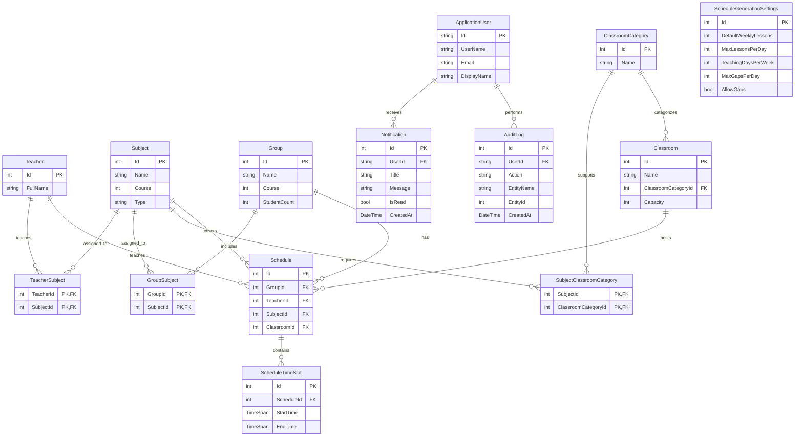

# Database ER Diagram

## Overview

ScheduleSystem uses PostgreSQL as its relational database and Entity Framework Core with the Code First approach to manage the database schema.

The database stores user accounts, teachers, subjects, student groups, classrooms, schedules, notifications, audit logs, and automatic schedule generation data.

The main database components are:

- **ASP.NET Core Identity** — user accounts, authentication, and roles.
- **Academic entities** — teachers, subjects, groups, and classrooms.
- **Schedule management** — schedules, time slots, and generation settings.
- **Supporting entities** — classroom categories, notifications, and audit logs.

## Entity Relationship Diagram



> **Note:** The diagram is a conceptual representation of the main entities. For exact column names, nullability, indexes, and delete behaviors, refer to the current entity classes, `ApplicationDbContext`, and EF Core migrations.

## Main Relationships

### 1. Teacher ↔ Subject

The many-to-many relationship between teachers and subjects is implemented through `TeacherSubject`.

A teacher can teach several subjects, and a subject can be assigned to several teachers.

```text
Teacher ── TeacherSubject ── Subject
```

The junction entity uses a composite primary key:

```text
(TeacherId, SubjectId)
```

This relationship supports teacher assignment and schedule validation.

### 2. Group ↔ Subject

The many-to-many relationship between student groups and subjects is implemented through `GroupSubject`.

```text
Group ── GroupSubject ── Subject
```

It represents the subjects associated with each group and is used by the scheduling functionality to determine which subjects can be scheduled for a group.

### 3. Subject ↔ ClassroomCategory

The many-to-many relationship between subjects and classroom categories is implemented through `SubjectClassroomCategory`.

```text
Subject ── SubjectClassroomCategory ── ClassroomCategory
```

A subject may require a particular classroom category. For example, a computer graphics lesson may require a computer classroom.

The junction entity uses the composite primary key:

```text
(SubjectId, ClassroomCategoryId)
```

### 4. ClassroomCategory → Classroom

Each classroom is associated with a classroom category.

```text
ClassroomCategory ── Classroom
```

The category describes the classroom type, while `Capacity` determines the maximum number of students the room can accommodate.

These properties support classroom recommendations and validation.

### 5. Group → Schedule

A group can have multiple schedule entries.

```text
Group ── Schedule
```

Each schedule entry associates a group with a teacher, a subject, and a classroom.

### 6. Teacher → Schedule

A teacher can have multiple schedule entries at different times.

The schedule validation functionality checks for conflicting assignments so that a teacher is not scheduled to teach multiple lessons simultaneously.

### 7. Subject → Schedule

Each schedule entry references the subject being taught.

The group-subject and teacher-subject relationships help determine whether the planned lesson is consistent with the system's academic assignments.

### 8. Classroom → Schedule

A classroom can be assigned to multiple schedule entries at different times.

Schedule validation checks for overlapping room assignments and other relevant constraints.

### 9. Schedule → ScheduleTimeSlot

A schedule can be associated with time-slot records.

```text
Schedule ── ScheduleTimeSlot
```

`ScheduleTimeSlot` stores time intervals used by scheduling functionality. Its exact role should be interpreted alongside the current generator and scheduling models.

### 10. ApplicationUser → Notification

A user can have multiple notification records.

Notifications contain information such as a title, message, read status, and creation timestamp.

### 11. ApplicationUser → AuditLog

A user can be associated with multiple audit log records.

Audit logs store information about recorded actions, including the action name, affected entity, entity identifier, and timestamp.

The completeness of the audit history depends on which application operations explicitly write audit records.

## Simplified Database Structure

```text
                 ApplicationUser
                    /        \
                   ▼          ▼
             Notification   AuditLog


Teacher ───── TeacherSubject ───── Subject
                                      │
                                      ├──── GroupSubject ───── Group
                                      │
                                      └──── SubjectClassroomCategory
                                                      │
                                                      ▼
                                              ClassroomCategory
                                                      │
                                                      ▼
                                                  Classroom


Group ───────────────┐
Teacher ─────────────┤
Subject ─────────────┼──────── Schedule ───── ScheduleTimeSlot
Classroom ───────────┘
```

This diagram illustrates the principal relationships. It does not include every Identity table or every configuration and supporting entity.

## Schedule Generation

`ScheduleGenerationSettings` represents stored settings associated with automatic schedule generation.

The documented configuration may include:

| Parameter | Description |
|---|---|
| `DefaultWeeklyLessons` | Default number of lessons per week |
| `MaxLessonsPerDay` | Maximum lessons per day |
| `TeachingDaysPerWeek` | Number of teaching days per week |
| `MaxGapsPerDay` | Maximum gaps allowed per day |
| `AllowGaps` | Whether gaps are permitted |

The generator uses academic entities, classroom availability, time slots, and scheduling constraints to construct a timetable.

**Important:** Stored database settings and generator form defaults are not necessarily identical. Actual values depend on the current entity definitions, application configuration, and request parameters. Verify the current model and generator before documenting specific default values.

The generation workflow includes a preview and administrator confirmation before the generated schedule is saved.

## Data Integrity

The database structure supports data integrity through:

- **Primary keys** — uniquely identify records.
- **Foreign keys** — connect related entities.
- **Composite primary keys** — identify records in junction entities such as `TeacherSubject` and `SubjectClassroomCategory`.
- **Entity Framework Core migrations** — track and apply database schema changes.
- **PostgreSQL constraints** — enforce configured relational integrity rules.

Application-level validation additionally checks scheduling constraints, including teacher, group, and classroom conflicts, as well as relevant classroom and subject requirements.

A validation rule enforced by application code should not be assumed to be a database constraint unless it is explicitly configured in the database schema.

## Database Technology

The database access stack is:

```text
ASP.NET Core MVC
        │
        ▼
Entity Framework Core
        │
        ▼
Npgsql Provider
        │
        ▼
PostgreSQL
```

| Component | Purpose |
|---|---|
| ASP.NET Core MVC | Handles application requests and user interactions |
| Entity Framework Core | Maps entities to database tables and manages queries |
| Npgsql | Connects Entity Framework Core to PostgreSQL |
| PostgreSQL | Stores application data |
| ASP.NET Core Identity | Manages user accounts, authentication, and roles |

**Database name:** `schedulesystem`

**Connection string setting:** `DefaultConnection`

The connection string should be configured through application configuration or environment variables. Real database passwords and other secrets should not be committed to source control.

## Entity Framework Core Migrations

The following commands are used to manage the database schema from the project directory:

```powershell
dotnet ef migrations add MigrationName
dotnet ef database update
dotnet ef migrations has-pending-model-changes
```

- `migrations add` creates a migration from model changes.
- `database update` applies pending migrations to the configured database.
- `has-pending-model-changes` checks whether the current model differs from the latest migration snapshot.

Before applying migrations to a production database, back up the database and review the generated migration.

## Related Documentation

- `TechnicalDocumentation.md` — technical implementation details.
- `Architecture.md` — application architecture.
- `ArchitectureDiagram.md` — architecture diagrams.
- `Deployment.md` — deployment instructions.
- `AdminGuide.md` — administrator guide.
- `UserGuide.md` — user guide.
